<div align="center">


# PVEpanel

**飞牛 fnOS 原生 Proxmox VE 监控面板** · 概览 / 虚拟机 / 存储 / 磁盘 / 任务 / 通知

纯 Python 3 标准库后端 · Vue 3 单页前端 · 零第三方依赖 · 桌面端与手机端自适应

[功能](#功能一览) · [截图](#界面预览) · [安装](#安装) · [使用手册](#使用手册) · [常见问题](#常见问题) · [更新日志](CHANGELOG.md) · [English](README_EN.md)

</div>

---

## 这是什么

PVEpanel 把 Proxmox VE 的运行状态做成一个可以在飞牛 fnOS 桌面直接点开的原生应用（`.fpk`）。
它不是一个「换个皮的网页壳」，而是一套完整的监控视图，并且**浏览器永远不直连 PVE**：

- **面板自带一个本地服务**，浏览器只跟它通信，所有请求由面板代为转发；
- **集群地址和 API Token 只保存在设备本地**，不写进网页、不经过任何外部服务器；
- **不用额外装 Python 包、Node、数据库**：后端只用 Python 3 标准库，前端 Vue 3 随包分发，离线可用；
- **一个包通吃 x86 与 ARM** 飞牛设备（应用本身不含任何架构相关二进制）。

它适合这样的场景：家里或机房里跑着 PVE，你想知道内存快到顶了、哪台虚拟机昨晚自己停了、哪块盘的
温度在爬升、有没有虚拟机根本没有被备份任务覆盖——这些信息本该扫一眼就看到，而不是逐台点进
PVE 的控制台。

> PVEpanel 是**监控面板**，不是 PVE 的管理端。写操作只有虚拟机的开机 / 关机 / 强制停止 / 重启，
> 其余全部只读。

---

## 功能一览

| 模块 | 能力 |
|---|---|
| **概览** | 节点 CPU / 内存 / 负载各占一张卡，数字不会互相掩盖；集群仲裁与 HA 状态、运行时长、内核与启动方式；**警告汇总**；资源曲线（时 / 日 / 周 / 月 / 年五档，横轴按真实时间刻度）；存储水位 |
| **虚拟机** | VM 与容器混排；全部 / 运行 / 停止筛选，按名称或 VMID 搜索；CPU、内存占用、运行时长、模板标记；**开机 / 关机 / 强制停止 / 重启**（带二次确认，强制停止会额外提示可能丢数据） |
| **存储** | 每个存储一行：用量圆环、已用 / 总量、可用、内容类型、节点、是否共享、在线状态 |
| **磁盘** | 物理盘型号容量、健康状态、**温度**、SSD 寿命；以及「未被任何备份覆盖」的虚拟机清单 |
| **任务** | 备份 / 迁移 / 启停记录与成败，每页 10 条可翻页；订阅状态；系统服务健康 |
| **设置 · 服务器** | 多台 PVE 卡片式管理；添加 / 编辑 / 删除；**可以单独测试非当前服务器**；一键设为当前 |
| **设置 · 通知** | 九种推送渠道；十二类事件逐条开关；按事件冷却去重，同一条告警不会反复刷屏 |
| **设置 · 维护** | 配置导出 / 导入、导出到设备备份目录、自动备份（间隔 + 保留天数）、备份列表恢复与删除 |
| **设置 · 更新** | 读取 GitHub 最新发布版本并与当前版本对比；**一键更新**（先校验安装包再卸载，装不上自动回滚） |
| **设置 · 主题** | 夜间 / 日间 / 跟随系统三态；中英双语；刷新间隔 |
| **移动端** | 抽屉式侧栏、卡片式布局、表格横向滑动、无横向溢出 —— 在飞牛手机 App 内嵌浏览器里同样顺手 |
| **深链** | `?view=` `?tab=` `?tf=` `?lang=` `?theme=` `?server=` 参数，可直接打开某个页面、某个图表档位或强制某个主题 |

### 警告覆盖哪些情况

节点离线 · 集群失去仲裁 · 存储水位超阈值 · **虚拟机无备份** · 备份任务失败 ·
磁盘 SMART 异常 · **磁盘温度超阈值** · 负载偏高 · 内存紧张 · 订阅即将到期 · 权限不足 · Token 失效。

所有警告都可以通过九种通道推送到手机。

### 支持的通知渠道

Bark / Server 酱 / PushPlus / WxPusher / Telegram / 企业微信机器人 / 钉钉机器人 / Slack / 自定义 Webhook。

---

## 界面预览

桌面端（1440px）：

| 概览 · 浅色 | 概览 · 深色 |
|---|---|
| 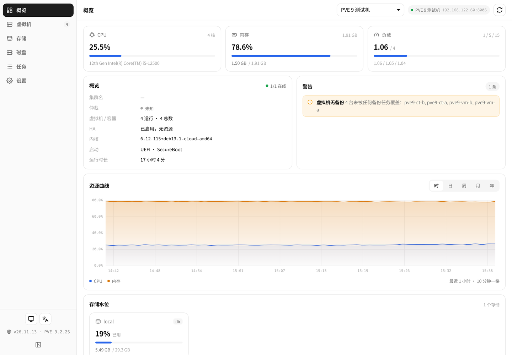 | 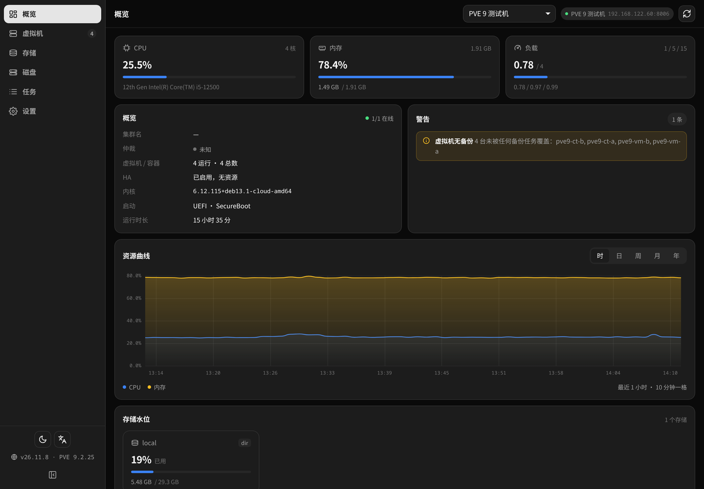 |

| 虚拟机 | 存储 |
|---|---|
| 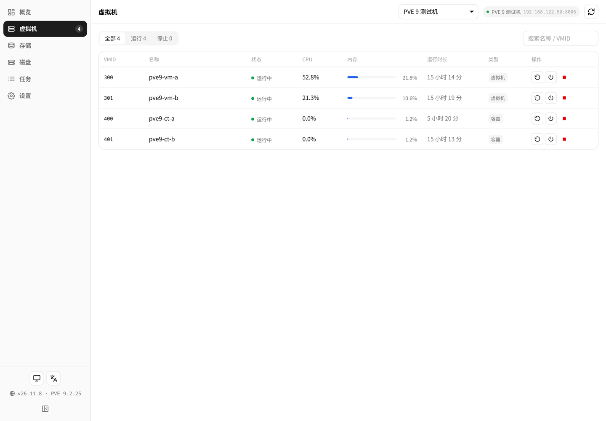 | 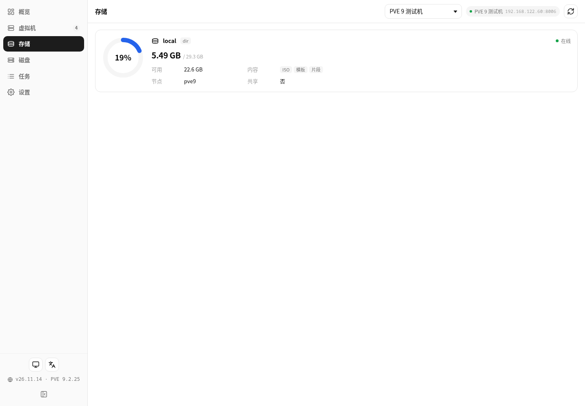 |

| 磁盘 | 任务 |
|---|---|
| 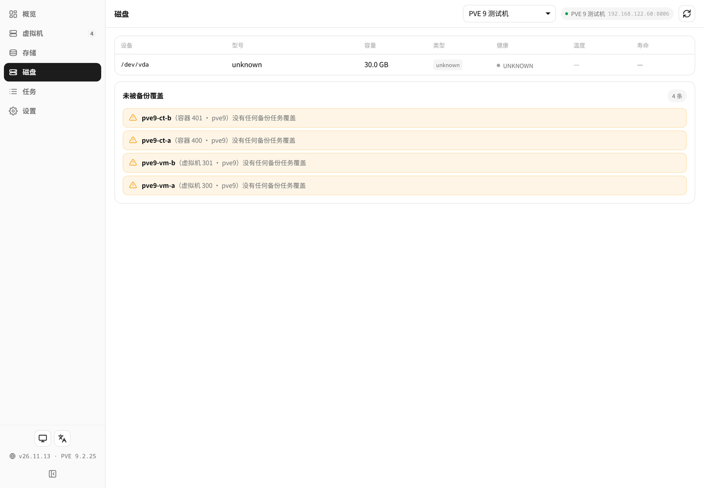 | 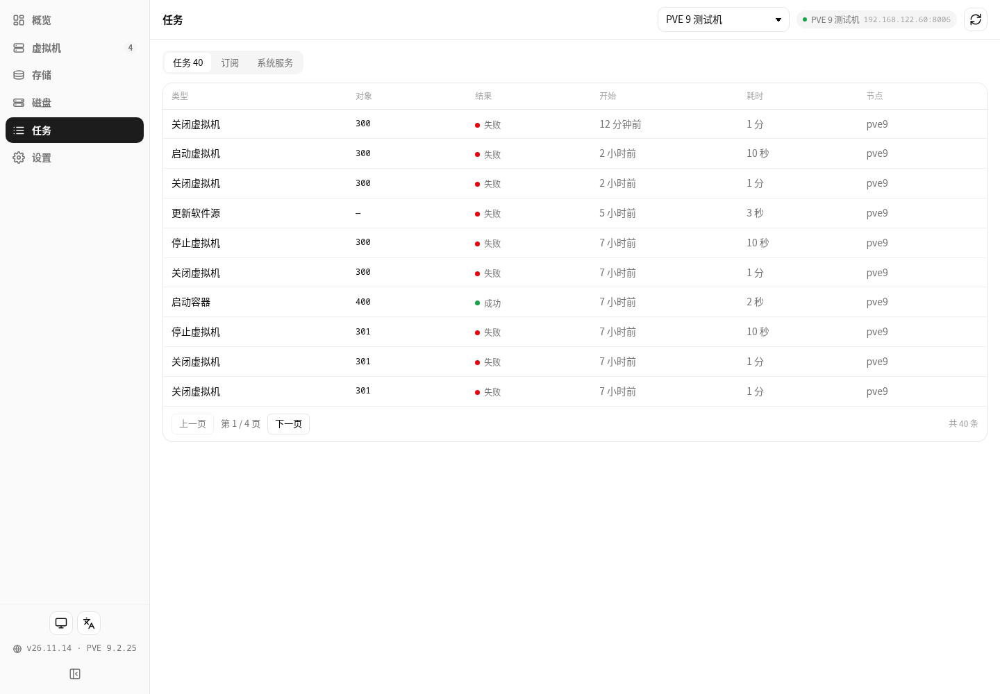 |

| 服务器 | 更新 |
|---|---|
| 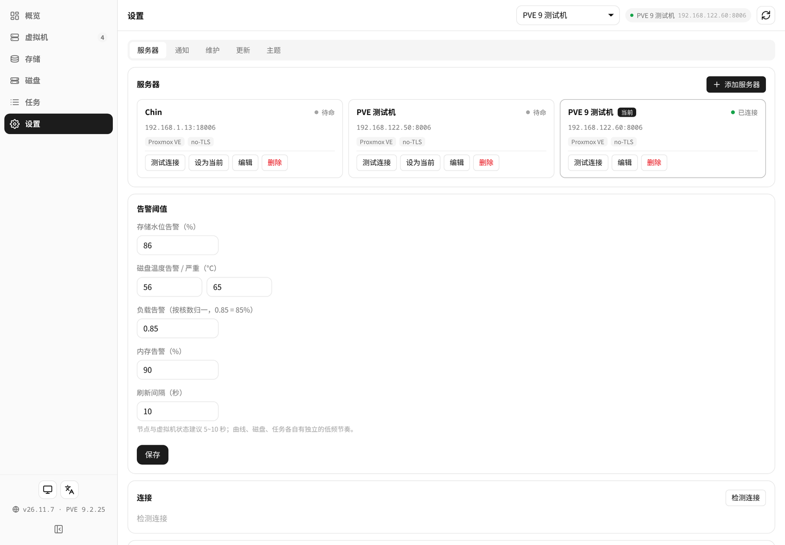 | 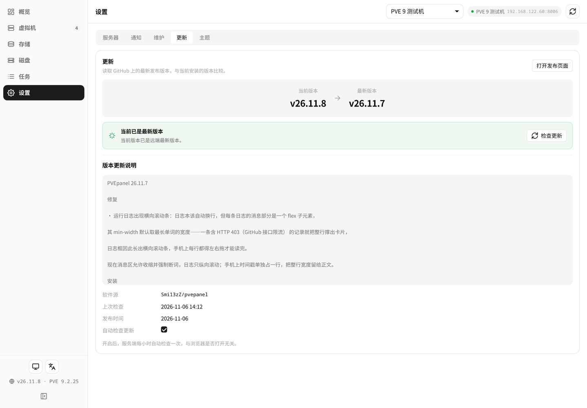 |

手机端（390px）：

| 概览 | 虚拟机 | 设置 |
|---|---|---|
| 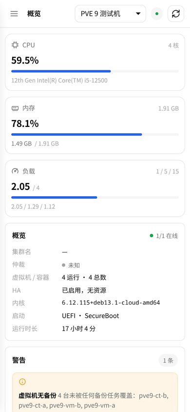 | 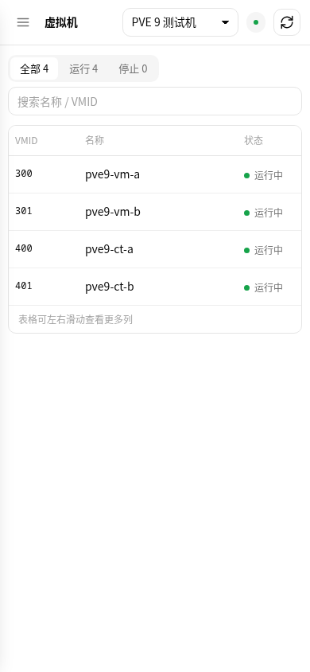 | 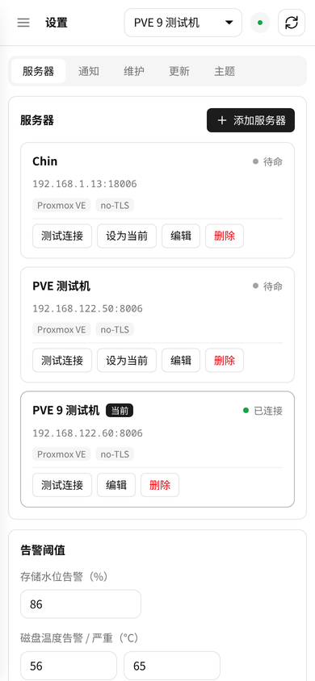 |

---

## 安装

### 前置条件

- 一台飞牛 fnOS 设备（x86 或 ARM 均可），系统已内置 Python 3；
- 一台可访问的 Proxmox VE（7 / 8 / 9 均可），以及一个只读 API Token（见下）。

### 方式一：应用中心手动安装（推荐）

1. 到本仓库的 [Releases](../../releases) 页面下载最新的 `fn-pvepanel-<版本>-fnos-all.fpk`；
2. 打开飞牛 fnOS → **应用中心** → **手动安装**，选择刚下载的 fpk；
3. 安装向导会让你填面板端口（留空即可，面板会自己在 20000–59999 里挑一个空闲端口）；
4. 装好后飞牛桌面会出现 **PVEpanel** 图标，点开即用。

### 方式二：命令行安装

```bash
appcenter-cli install-fpk /path/to/fn-pvepanel-26.11.11-fnos-all.fpk
```

> `appcenter-cli` 安装时必须提供环境变量文件（`-e`）；它**不会覆盖已安装的同名应用**，
> 升级前需要先 `appcenter-cli uninstall fn-pvepanel`。已经在旧版本的，直接在面板里点一键更新即可。

### 安装位置

| 内容 | 路径 |
|---|---|
| 程序 | `/usr/local/apps/@appcenter/fn-pvepanel` |
| 配置、Token、日志与备份 | `/usr/local/apps/@appdata/fn-pvepanel` |

---

## 准备 PVE 的只读 Token

PVE 用 API Token 授权。**一个 `PVEAuditor` 角色就够**，但它必须授在 `/` 并开启 propagate：

```bash
# 1) 建一个专用用户
pveum user add monitor@pve --comment "PVEpanel read-only"

# 2) 授只读角色到根路径（propagate 不能省）
pveum acl modify / --users monitor@pve --roles PVEAuditor --propagate 1

# 3) 建 Token（privsep 保持默认 1）
pveum user token add monitor@pve panel --comment "PVEpanel"

# 4) Token 默认 privsep=1，权限取「用户 ∩ Token」，所以 Token 自己也要授一遍
pveum acl modify / --tokens 'monitor@pve!panel' --roles PVEAuditor --propagate 1
```

第 3 步会输出一次性的 uuid，拼成 `monitor@pve!panel=xxxxxxxx-xxxx-xxxx-xxxx-xxxxxxxxxxxx`
填进面板即可。**它只显示一次，务必当场保存。**

> `pveum` 在 `/usr/sbin`，如果 `ssh root@pve "pveum ..."` 报 command not found，
> 用 `/usr/sbin/pveum` 全路径或 `bash -lc 'pveum ...'`。

### 为什么必须授在根路径

只授在 `/nodes/<node>` 子树的话，`/cluster/status` 与 `/nodes/<node>/disks/smart`
会直接 403 —— 这两个端点查的是**根路径**权限。面板会把这种情况显示成
「权限不足，请确认 PVEAuditor 授在 / 并开启 propagate」，而不是笼统的「连接失败」。

### 想让面板启停虚拟机

`PVEAuditor` 是纯只读，**不含 `VM.PowerMgmt`**。要启停就再给一条：

```bash
pveum acl modify /vms --users monitor@pve --roles PVEVMAdmin --propagate 1
pveum acl modify /vms --tokens 'monitor@pve!panel' --roles PVEVMAdmin --propagate 1
```

没有这条权限时按钮不会消失，点了会明确提示「权限不足」，比藏起来更好排查。

---

## 使用手册

### 1. 添加你的 PVE

首次打开面板会看到「还没有服务器」。点 **添加服务器**：

| 字段 | 说明 |
|---|---|
| 名称 | 随便起，会显示在顶栏 |
| 地址 | **写在设备上能访问到的地址**，只填 IP 或主机名，不用写 `https://` 和端口 |
| 端口 | 默认 `8006` |
| API Token | 上面生成的 `user@realm!tokenid=uuid` 整串 |
| 校验 TLS 证书 | PVE 默认自签证书，通常保持关闭 |

保存后顶栏会显示连接状态与当前地址。多台 PVE 可以一起管，**概览只显示当前那一台**——
不会把两台机器的数字混成一张图。

Token 存进面板后，浏览器只能拿到 `__SET__` 掩码；编辑时 Token 框留空表示保留原值。

### 2. 概览页

三张数字卡分别显示 CPU、内存、负载 —— **它们是分开的**，一个数字异常不会被另一个掩盖。
下面是集群概况（仲裁、HA、内核、启动方式、运行时长）、警告汇总、资源曲线与存储水位。

资源曲线有五个档位，横轴按真实时间刻度：

| 档位 | 跨度 | 每格 |
|---|---|---|
| 时 | 最近 1 小时 | 10 分钟 |
| 日 | 最近 1 天 | 2 小时 |
| 周 | 最近 1 周 | 1 天 |
| 月 | 最近 1 月 | 5 天 |
| 年 | 最近 1 年 | 2 个月 |

### 3. 虚拟机页

VM 与容器混排在同一张表。可以按「全部 / 运行 / 停止」筛选，按名称或 VMID 搜索。

每行右侧的操作按钮：运行中的是**重启 / 关机 / 强制停止**，停止状态时是**开机**。
强制停止是红色，并会额外弹一句「相当于拔电源，可能丢失数据」。
表格较宽时可以横向滑动查看全部列（CPU、内存、运行时长、类型……都在）。

### 4. 存储 / 磁盘 / 任务页

- **存储**：一个存储一行，圆环显示水位，右侧是可用、内容类型、节点、是否共享；
- **磁盘**：设备、型号、容量、类型、健康、**温度**、SSD 寿命；下方单独列出「未被备份覆盖」的虚拟机；
- **任务**：顶部三个页签「任务 / 订阅 / 系统服务」。任务列表每页 10 条可翻页。

### 5. 通知

「设置 → 通知」里添加渠道，十二类事件可以逐条开关。推送的判据就是面板上显示的警告——
**同一条规则不会出现「页面红了但没推送」或反过来**。

每个事件带冷却时间（存储 6 小时、负载 30 分钟、订阅 24 小时……），同一条告警重复出现时不会反复推送。
每个渠道都能单独「测试」，密钥只存本机且不回显。

### 6. 维护与更新

**维护**：配置可以整体导出 / 导入。两种备份的取舍是有意为之——

- **下载到本地的**不含 API Token（文件会离开设备）；
- **设备上的自动备份**保留 Token，否则恢复出来是个不能用的面板，还得把每台机器的 Token 重填一遍。

自动备份可设间隔与保留天数；保留期只清理自动备份，不动手动导出的。

**更新**：后台每小时自查一次（与浏览器开没开无关）。发现新版本可以一键更新——
面板下载安装包、校验通过后才卸载旧版，装不上会自动回滚。升级过程中页面会自动等待新版本上线。

### 7. 手机端与深链

在飞牛 App 里打开会自动切换移动布局；浏览器直接访问时宽度小于 640px 也进入同一套布局。

| 参数 | 取值 | 作用 |
|---|---|---|
| `view` | `dash` / `guests` / `storage` / `disks` / `tasks` / `settings` | 直接打开指定页面 |
| `tab` | `servers` / `notify` / `maint` / `update` / `ui` | 打开设置里的指定分区 |
| `tf` | `hour` / `day` / `week` / `month` / `year` | 资源曲线的档位 |
| `lang` | `zh` / `en` | 强制界面语言 |
| `theme` | `dark` / `light` / `auto` | 强制主题 |
| `server` | 服务器 id | 直接切到某台 PVE |

---

## 常见问题

**连不上 / 提示 Token 失效**
先用「设置 → 服务器 → 测试连接」看是哪一步失败，它会分成「连通性 / 认证域 / Token / 权限」四步回答，
比一句笼统的「连接失败」好定位。

**提示权限不足，但 Token 看起来是对的**
`PVEAuditor` 必须授在 `/` 并 `--propagate 1`。只授在节点子树会让 `/cluster/status` 403。

**为什么虚拟机启停按钮点了提示权限不足**
`PVEAuditor` 不含 `VM.PowerMgmt`，需要额外给 `/vms` 的 `PVEVMAdmin`。

**看不到 CPU / 主板温度、风扇转速**
PVE 的 API 层没有这些端点（437 个叶子端点里相关关键字命中 0），不是面板没做。
**磁盘温度是可以拿的**，ATA / NVMe / SAS 分别走不同分支解析。

**面板能访问，但数据一直是空的**
检查 PVE 是否可达、Token 是否过期。面板在取不到数据时会保留最后一次成功的结果并标记为「已冻结」，
而不是清空成 0 —— 巡检时你需要看到出事前的样子。

**数据存在哪？**
配置、Token、日志与备份都在 `/usr/local/apps/@appdata/fn-pvepanel`。

---

## 安全说明

- PVE 的地址与 Token 只保存在设备本地，不写入网页、不上传任何外部服务；
- **面板监听 `127.0.0.1`**，只通过飞牛桌面入口的 CGI 访问，那条路有 fnOS 登录校验。
  如果改成对外监听，任何能访问该端口的人都能看到整个集群的状态，需要自行加认证；
- 导出的备份（未含 Token）与设备上的自动备份（含 Token）请妥善保管。

---

## 已知限制

- **崩溃不自愈**：开机自启是有的，但进程被 `kill -9` 后没有东西会把它拉回来，
  到应用中心点一下启动即可；
- **写操作只有虚拟机启停**：快照、备份触发、创建 / 删除虚拟机都未实现；
- **没有告警历史**：面板显示当前状态，历史趋势看资源曲线，但没有独立的告警时间线；
- 集群（多节点）场景下，曲线只取第一个节点的 RRD。

---

## 从源码构建

源码结构：

```
src/fn-pvepanel/
├── manifest                 # 应用元信息：包名、版本、端口、平台
├── ICON.PNG / ICON_256.PNG  # 应用图标（64 / 256）
├── config/                  # 运行身份（root）与应用文件夹声明
├── wizard/                  # 安装向导（说明端口是自动挑选的）
├── cmd/main                 # 生命周期脚本：start / stop / status，并负责选端口
└── app/
    ├── server/              # pvepanel.py（HTTP 服务与路由）、collector.py（采集与缓存）、
    │                        # pveclient.py（连接池）、store.py（配置与 Token）、
    │                        # notify.py（九种通道）、update.py、installer.py、maint.py
    ├── web/                 # index.html + style.css + js/ + lib/vue.global.prod.js
    └── ui/                  # 桌面入口（index.cgi 反代到本地端口）与九档图标
```

仓库自带 `.github/workflows/build-fpk.yml`：推 `v*` 标签会自动构建、校验并发布 Release。
本地打包**只能在 Linux 上做**（Windows 会丢可执行位，安装报 10111），
`tools/build_fpk.py` 通过 SSH 在飞牛设备上用官方 `fnpack` 完成。

```bash
python tools/build_fpk.py     # 结构检查 → 打包
python tools/deploy.py        # 卸载旧版 → 装新版 → 起服务 → 探活
python tools/preflight.py     # 跑齐 CI 的全部闸门
```

### 端口

面板的端口不是固定值：首次启动时在 **20000–59999** 里随机挑一个当前空闲的，
写进 `@appdata/fn-pvepanel/backend-port`，之后一直使用（重启、升级、重装都不变）。
这样不会和 8899 这类常用端口撞车，也少一个可枚举的入口。

需要固定端口时（例如做可重复的部署），显式传环境变量即可覆盖：

```bash
python tools/deploy.py --env BACKEND_PORT=25000
```

> 内置的 `deploy.py` / `shot.py` 会自动读取这个文件，不需要手动指定端口。

---

## 许可

[MIT](LICENSE) © 2026 Smi13zZ

本项目与 Proxmox Server Solutions GmbH、飞牛 fnOS 官方均无隶属关系。
Proxmox VE 是 Proxmox Server Solutions GmbH 的商标。
