<div align="center">


# PVEpanel

**A native Proxmox VE monitoring panel for fnOS** · Overview / Guests / Storage / Disks / Tasks / Notifications

Pure Python 3 stdlib backend · Vue 3 SPA front-end · zero third-party dependencies · desktop and mobile friendly

[Features](#features) · [Screenshots](#screenshots) · [Install](#install) · [Usage](#usage) · [FAQ](#faq) · [Changelog](CHANGELOG.md) · [中文说明](README.md)

</div>

---

## What it is

PVEpanel turns the state of a Proxmox VE cluster into a **native fnOS application** (`.fpk`) that opens
straight from the fnOS desktop. It is not a "wrapped webpage" — and **the browser never talks to PVE**:

- **The panel ships its own local service**; the browser only talks to that, and every request is relayed on your behalf.
- **Cluster addresses and API tokens live on the device only** — never rendered into a page, never sent to an external server.
- **Zero dependencies.** The backend uses only the Python 3 standard library; the Vue 3 build is bundled locally, so everything works offline.
- **One package for both x86 and ARM** fnOS boxes (nothing in the app is architecture-specific).

It is for the questions you end up asking every day: is memory about to run out, did a guest stop by
itself last night, is a disk's temperature creeping up, and is there a VM that no backup job covers at all?
Those should be one glance away, not five clicks deep in a Proxmox console.

> PVEpanel is a **monitoring panel**, not a Proxmox management console. The only write actions are
> start / shutdown / force-stop / reboot of a guest; everything else is read-only.

---

## Features

| Area | What you get |
|---|---|
| **Overview** | CPU, memory and load each get their own card so one bad number cannot hide behind another; cluster quorum and HA state, uptime, kernel and boot mode; **warning summary**; resource history (hour / day / week / month / year, with a real time axis); storage usage |
| **Guests** | VMs and containers in one list; filter by all / running / stopped; search by name or VMID; CPU and memory use, uptime, template marker; **start / shutdown / force-stop / reboot** with confirmation (force-stop warns about data loss) |
| **Storage** | One row per storage: usage ring, used / total, available, content types, node, shared flag, online state |
| **Disks** | Physical drives with model, size, health, **temperature** and SSD wear; plus the list of guests **not covered by any backup job** |
| **Tasks** | Backup / migration / power tasks with result, paginated 10 per page; subscription status; system service health |
| **Settings · Servers** | Manage several PVE endpoints as cards; add / edit / delete; **test an endpoint without switching to it**; set as current |
| **Settings · Notifications** | Nine push channels; twelve event types toggled individually; per-event cooldown so one alert cannot spam you |
| **Settings · Maintenance** | Export / import configuration, export to the on-device backup folder, automatic backups (interval + retention), restore or delete any backup |
| **Settings · Update** | Reads the latest GitHub release and compares it with the running build; **one-click update** (package verified before uninstalling, automatic rollback if it fails to start) |
| **Settings · Appearance** | Dark / light / follow-system, Chinese and English, refresh interval |
| **Mobile** | Drawer sidebar, card layouts, horizontally scrollable tables, no horizontal overflow — works inside the fnOS phone app's embedded browser |
| **Deep links** | `?view=` `?tab=` `?tf=` `?lang=` `?theme=` `?server=` to open a page, a chart range, or force a theme |

### What the warnings cover

Node offline · cluster lost quorum · storage above threshold · **guest without backup** · backup job failed ·
disk SMART error · **disk temperature above threshold** · high load · memory pressure · subscription expiring ·
permission denied · token invalid.

Every one of them can be pushed to your phone through the nine notification channels.

### Supported notification channels

Bark / Server Chan / PushPlus / WxPusher / Telegram / WeCom bot / DingTalk bot / Slack / custom webhook.

---

## Screenshots

Desktop (1440px):

| Overview · light | Overview · dark |
|---|---|
| 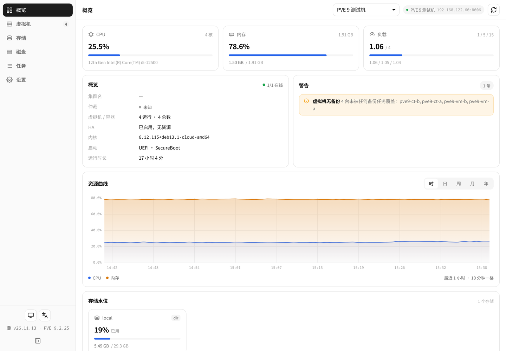 | 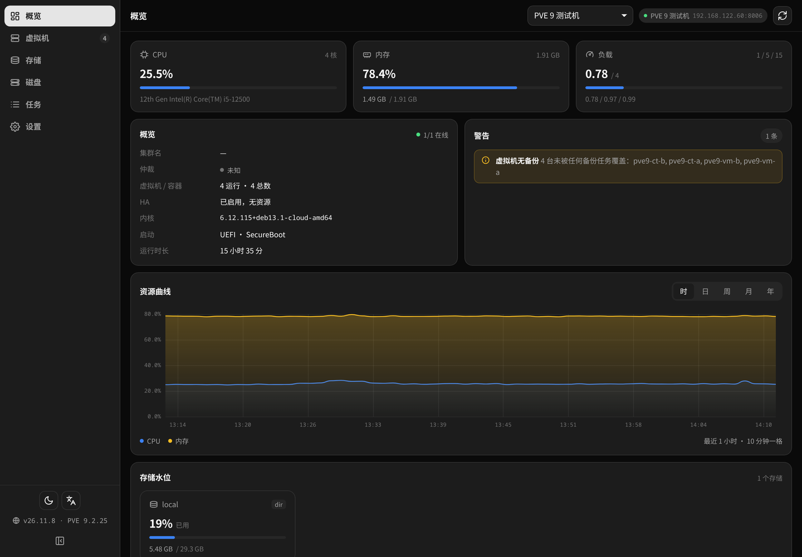 |

| Guests | Storage |
|---|---|
| 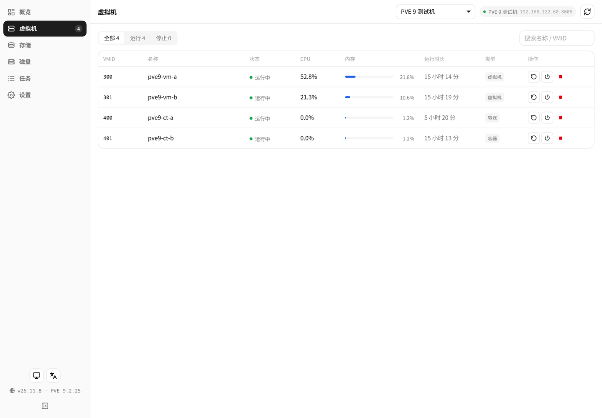 | 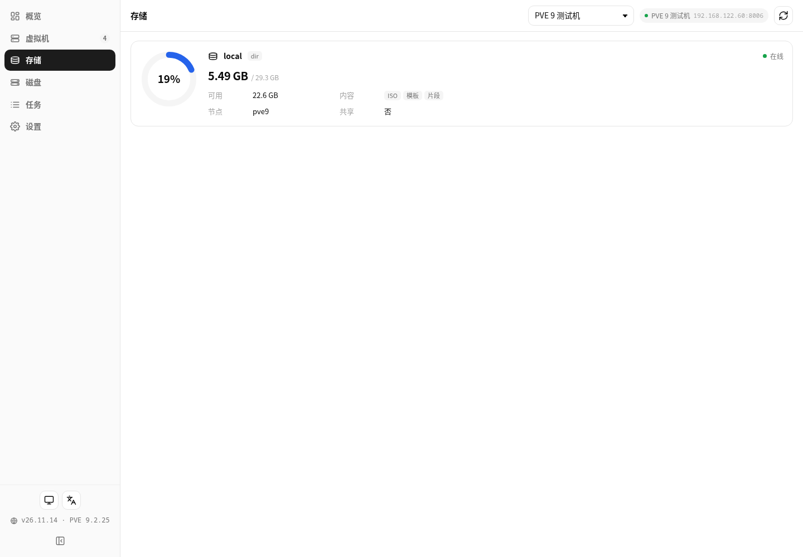 |

| Disks | Tasks |
|---|---|
| 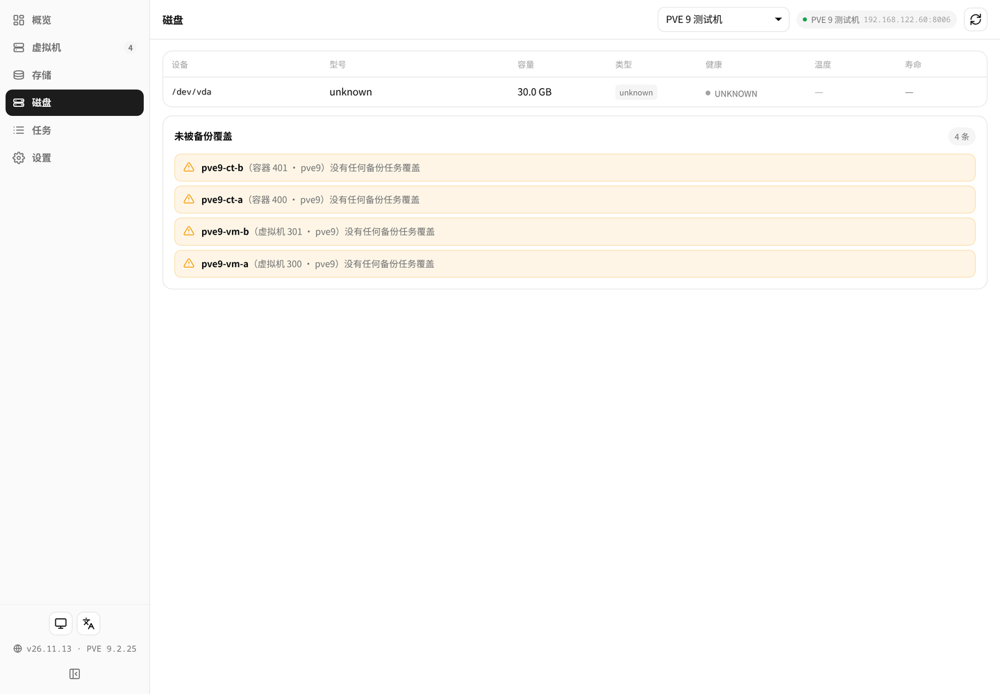 | 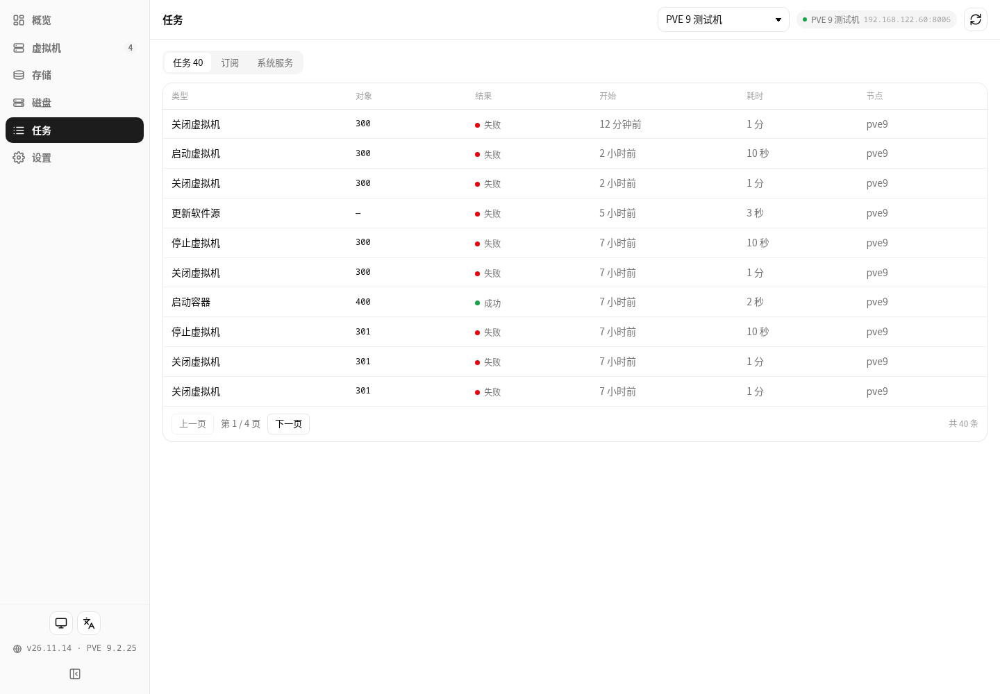 |

| Servers | Update |
|---|---|
| 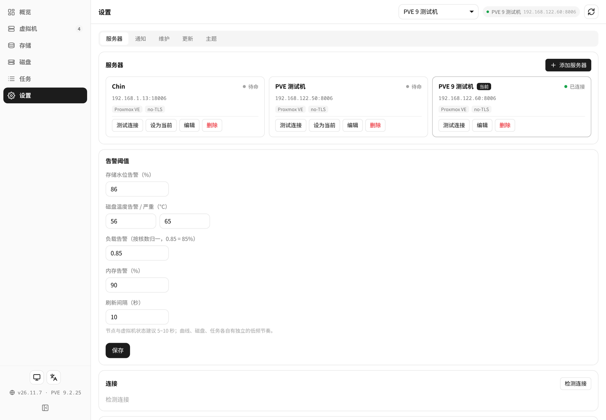 | 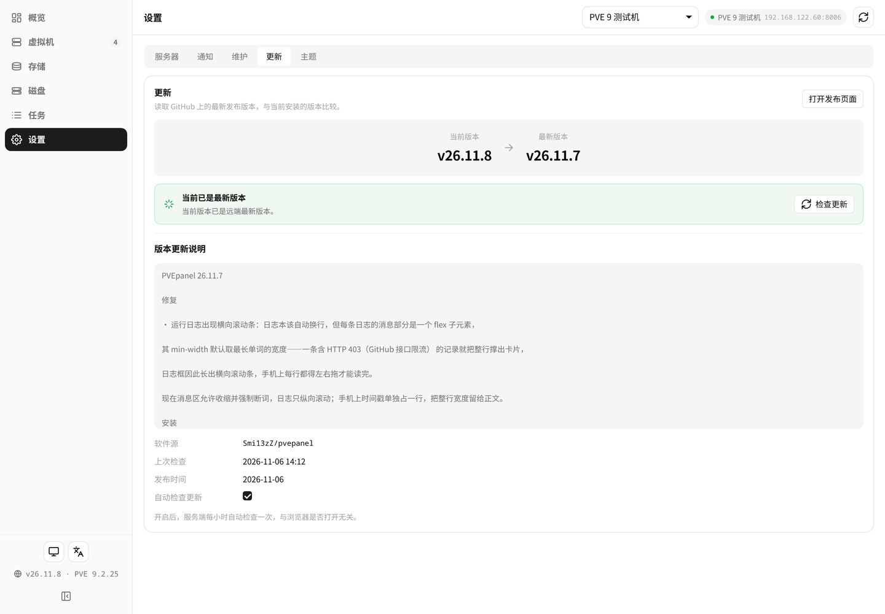 |

Mobile (390px):

| Overview | Guests | Settings |
|---|---|---|
| 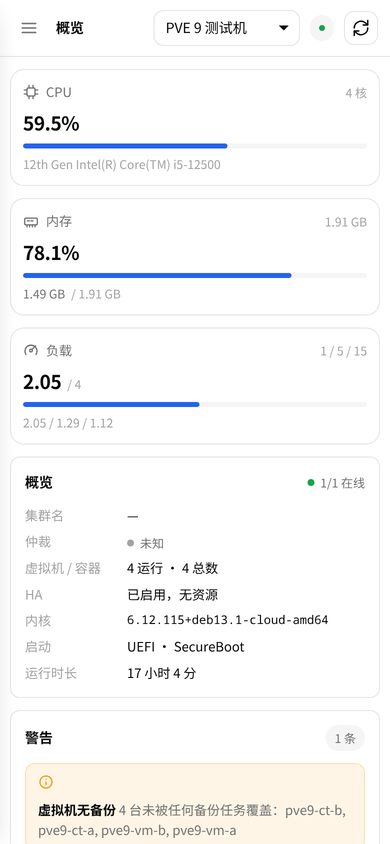 | 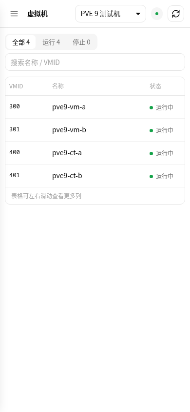 | 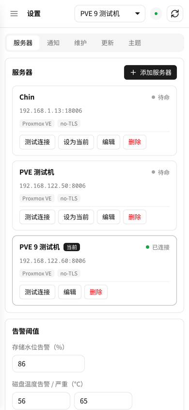 |

---

## Install

### Requirements

- An fnOS device (x86 or ARM) — fnOS ships Python 3;
- A reachable Proxmox VE (7 / 8 / 9) and a read-only API token (see below).

### Option 1: install from App Center (recommended)

1. Download the latest `fn-pvepanel-<version>-fnos-all.fpk` from [Releases](../../releases);
2. fnOS → **App Center** → **Manual install** → pick the file;
3. The wizard asks for the panel port (leave it empty — the panel picks a free port in 20000–59999);
4. A **PVEpanel** icon appears on the fnOS desktop.

### Option 2: install from the command line

```bash
appcenter-cli install-fpk /path/to/fn-pvepanel-26.11.11-fnos-all.fpk
```

> `appcenter-cli` requires the environment file (`-e`) and **will not overwrite an installed app** —
> uninstall first. If you are already running an older version, use the in-panel one-click update instead.

### Where things live

| Content | Path |
|---|---|
| Program | `/usr/local/apps/@appcenter/fn-pvepanel` |
| Config, tokens, logs, backups | `/usr/local/apps/@appdata/fn-pvepanel` |

---

## Prepare a read-only PVE token

A single `PVEAuditor` role is enough — but it must be granted on `/` **with propagate**:

```bash
# 1) a dedicated user
pveum user add monitor@pve --comment "PVEpanel read-only"

# 2) read-only role on the root path (propagate is not optional)
pveum acl modify / --users monitor@pve --roles PVEAuditor --propagate 1

# 3) create the token (keep privsep at its default of 1)
pveum user token add monitor@pve panel --comment "PVEpanel"

# 4) privsep=1 means effective = user ACL ∩ token ACL, so grant the token too
pveum acl modify / --tokens 'monitor@pve!panel' --roles PVEAuditor --propagate 1
```

Step 3 prints the uuid **once**. Paste it into the panel as
`monitor@pve!panel=xxxxxxxx-xxxx-xxxx-xxxx-xxxxxxxxxxxx` and save it right away.

> `pveum` lives in `/usr/sbin`. If `ssh root@pve "pveum ..."` says command not found, use the full
> path or `bash -lc 'pveum ...'`.

### Why the root path matters

Granted only on `/nodes/<node>`, the endpoints `/cluster/status` and `/nodes/<node>/disks/smart`
return 403 — they check permissions on the **root** path. The panel reports this as
"permission denied — check that PVEAuditor is granted on / with propagate" instead of a vague
"connection failed".

### Allowing guest power actions

`PVEAuditor` is strictly read-only and **does not include `VM.PowerMgmt`**. Add:

```bash
pveum acl modify /vms --users monitor@pve --roles PVEVMAdmin --propagate 1
pveum acl modify /vms --tokens 'monitor@pve!panel' --roles PVEVMAdmin --propagate 1
```

Without it the buttons stay visible and say "permission denied" when clicked — easier to diagnose
than hiding them.

---

## Usage

### 1. Add your PVE

First run shows "no server yet". Click **Add server**:

| Field | Notes |
|---|---|
| Name | Anything; shown in the top bar |
| Address | **As reachable from the fnOS device** — host or IP only, no `https://` and no port |
| Port | Default `8006` |
| API token | The whole `user@realm!tokenid=uuid` string |
| Verify TLS | PVE ships a self-signed certificate; usually off |

Multiple PVE endpoints can be managed together, but **the overview only ever shows the current one** —
numbers from two clusters are never mixed into one chart.

Once stored, the browser only ever sees the `__SET__` mask; leave the token field empty when editing
to keep the stored value.

### 2. Overview

Three cards for CPU, memory and load — **kept separate** so one out-of-range number cannot hide behind
another. Below them: cluster summary (quorum, HA, kernel, boot mode, uptime), the warning list,
resource history and storage usage.

The history chart has five ranges, with a real time axis:

| Range | Window | Tick spacing |
|---|---|---|
| Hour | last hour | 10 minutes |
| Day | last day | 2 hours |
| Week | last week | 1 day |
| Month | last month | 5 days |
| Year | last year | 2 months |

### 3. Guests

VMs and containers share one table. Filter all / running / stopped, search by name or VMID.

Row actions: **reboot / shutdown / force-stop** while running, **start** while stopped.
Force-stop is red and adds a second line warning that it is like pulling the power cord.
The table scrolls horizontally when needed — every column stays available.

### 4. Storage / Disks / Tasks

- **Storage**: one row each, usage ring plus available, content types, node, shared flag;
- **Disks**: device, model, size, type, health, **temperature**, SSD wear; the guests without any
  backup coverage are listed separately underneath;
- **Tasks**: three tabs — tasks / subscriptions / services. The task list shows 10 rows per page.

### 5. Notifications

Add channels under **Settings → Notifications**; twelve event types toggle individually.
The push rule is exactly the warning list you see on screen — there is no case where the panel shows
red but nothing is pushed, or the other way round.

Each event carries its own cooldown (storage 6h, load 30min, subscription 24h, …), so a recurring alert
does not repeat. Every channel can be tested on its own; secrets stay local and are never echoed back.

### 6. Maintenance and updates

**Maintenance**: the configuration can be exported and imported as a whole. The two kinds of backup
differ on purpose —

- **the downloaded copy carries no API tokens** (the file leaves the device);
- **the on-device automatic backups do keep them**, otherwise a restore would produce a panel that
  cannot connect and every token would have to be retyped.

Automatic backups take an interval and a retention period; retention only prunes automatic backups,
never the ones you exported by hand.

**Update**: checked hourly in the background, whether or not a browser is open. When a release exists,
one click downloads it, verifies the package, then uninstalls and installs — rolling back automatically
if the new build fails to start. The page waits for the new version to come up.

### 7. Mobile and deep links

Opening the panel inside the fnOS app switches to the mobile layout automatically; in a normal browser
the same layout kicks in below 640px.

| Parameter | Values | Effect |
|---|---|---|
| `view` | `dash` / `guests` / `storage` / `disks` / `tasks` / `settings` | Open a page directly |
| `tab` | `servers` / `notify` / `maint` / `update` / `ui` | Open a settings section |
| `tf` | `hour` / `day` / `week` / `month` / `year` | History chart range |
| `lang` | `zh` / `en` | Force the UI language |
| `theme` | `dark` / `light` / `auto` | Force a theme |
| `server` | server id | Switch to a specific PVE endpoint |

---

## FAQ

**Cannot connect / "token invalid"**
Use **Settings → Servers → Test connection**. It answers in four separate steps — reachability,
authentication realm, token, permissions — which is far more useful than one generic failure message.

**"Permission denied" even though the token looks right**
`PVEAuditor` must be granted on `/` with `--propagate 1`. Granted only on a node subtree,
`/cluster/status` returns 403.

**Why does the power button say permission denied?**
`PVEAuditor` does not include `VM.PowerMgmt`; grant `PVEVMAdmin` on `/vms` in addition.

**No CPU / motherboard temperature or fan speed?**
Proxmox exposes no such endpoints (none of the 437 leaf endpoints mention temperature, sensors or fans).
**Disk temperature is available** — ATA, NVMe and SAS are parsed through different branches.

**The panel loads but everything is empty**
Check that PVE is reachable and the token has not expired. When data cannot be fetched the panel keeps
the last good snapshot and marks it "frozen" rather than blanking every number — during an incident you
want to see what it looked like before.

**Where is the data stored?**
Configuration, tokens, logs and backups all live in `/usr/local/apps/@appdata/fn-pvepanel`.

---

## Security

- PVE addresses and API tokens are stored on the device only; nothing is rendered into the page and
  nothing is sent to an external service;
- **The panel listens on `127.0.0.1`** and is reached through the fnOS desktop entry's CGI, which is
  behind the fnOS login. If you make it listen externally, anyone who can reach that port can read the
  whole cluster — add authentication of your own first;
- Treat exported backups (no tokens) and on-device automatic backups (with tokens) accordingly.

---

## Known limitations

- **No self-healing**: the service starts with the system, but nothing restarts it after a `kill -9`.
  Start it again from App Center;
- **Write actions are limited to guest power state** — snapshots, triggering backups, creating or
  deleting guests are not implemented;
- **No alert history**: the panel shows current state and history charts, but there is no alert timeline;
- On a multi-node cluster the history chart reads RRD from the first node only.

---

## Build from source

```
src/fn-pvepanel/
├── manifest                 # package name, version, port, platform
├── ICON.PNG / ICON_256.PNG  # application icons (64 / 256)
├── config/                  # run-as identity (root), shared-folder declaration
├── wizard/                  # install wizard (explains the automatic port)
├── cmd/main                 # lifecycle: start / stop / status, picks the port too
└── app/
    ├── server/              # pvepanel.py (HTTP + routes), collector.py (collection + cache),
    │                        # pveclient.py (connection pool), store.py (config + tokens),
    │                        # notify.py (nine channels), update.py, installer.py, maint.py
    ├── web/                 # index.html + style.css + js/ + lib/vue.global.prod.js
    └── ui/                  # desktop entry (index.cgi reverse proxy) and nine icon sizes
```

`.github/workflows/build-fpk.yml` builds, verifies and publishes a Release when a `v*` tag is pushed.
Packaging **must happen on Linux** (Windows loses the executable bits and the install fails with 10111);
`tools/build_fpk.py` does it over SSH with the official `fnpack`.

```bash
python tools/build_fpk.py     # structure check, then package
python tools/deploy.py        # uninstall, install, start, probe
python tools/preflight.py     # run every CI gate locally
```

### Port

The panel does not use a fixed port. On first start it picks a free one in
**20000–59999**, stores it in `@appdata/fn-pvepanel/backend-port`, and keeps using it
across restarts, upgrades and reinstalls. That avoids colliding with common ports such as
8899 and removes one enumerable entry point.

To pin a port (for reproducible deployments) override it explicitly:

```bash
python tools/deploy.py --env BACKEND_PORT=25000
```

> The bundled `deploy.py` / `shot.py` read that file themselves — no port needed.

---

## License

[MIT](LICENSE) © 2026 Smi13zZ

Not affiliated with Proxmox Server Solutions GmbH or the fnOS project.
Proxmox VE is a trademark of Proxmox Server Solutions GmbH.
