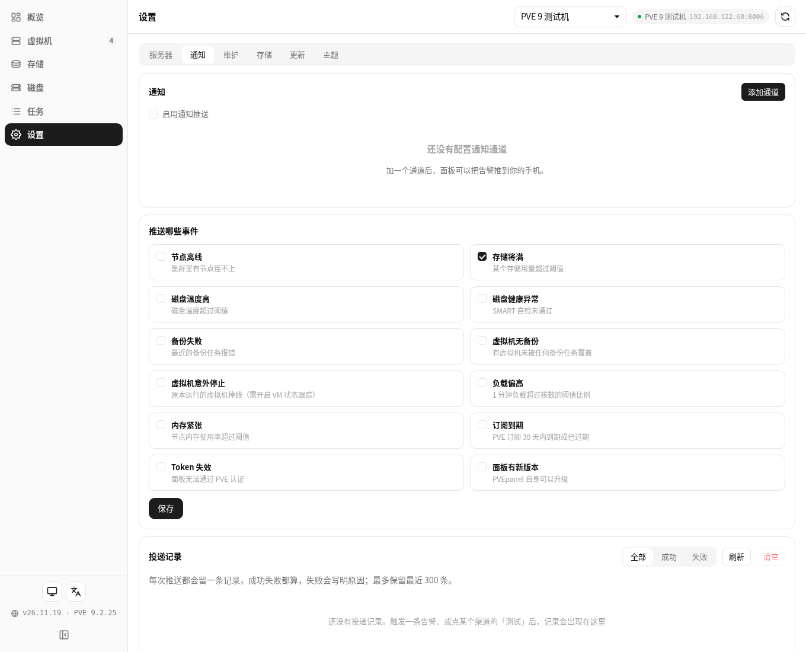

# 26.11.19 通知投递记录与推送双语

- 通知页新增**投递记录**：每次推送（告警、测试、版本更新）都留一条，成功失败都记，失败写明原因；
  支持全部 / 成功 / 失败筛选、刷新与清空；最多保留 300 条；只存本机，不含渠道密钥。
- 推送消息**改为中英双语**：标题「中文 / English」，正文中文段 + 空行 + 英文段。

## 验证（fnos-test）
- 覆盖升级到 26.11.19，status running；`preflight.py` 全绿（test_notify 220 / test_notify_log 55 / notify log api 36）。
- 端到端：打测试推送后 `GET /api/notify/log` 返回记录，标题 `[PVEpanel] 通知测试 / Notification test`，
  正文含中文段与英文段；`DELETE` 清空生效。
- 旧版本 26.11.18 面板对真实 Release 查更新 has_update=true。

## 已知限制
告警正文 detail 来自 collector 只有中文，英文段目前重复该句；彻底解决需给 collector 补英文文案。

